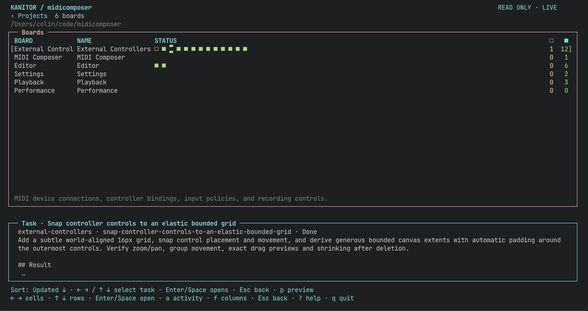
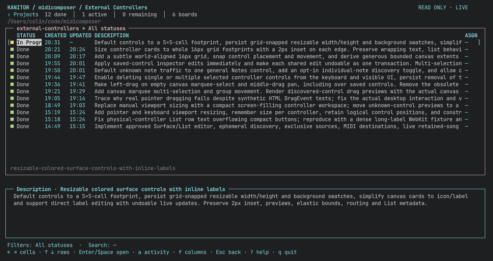
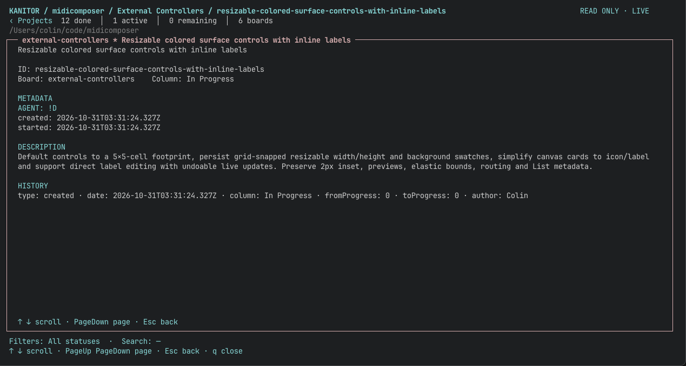

# Kanitor

A read-only terminal explorer for [kanbn](https://github.com/basementuniverse/kanbn).
Browse boards, filter tasks, and inspect card details.
The optional work recorder stores declared sessions separately from cards,
through JSON commands or a local MCP server.

**Alpha / preview:** tested on macOS with Python 3.14. Earlier Python versions
(3.11–3.13) and Linux may work, but have not been tested.

Kanbn + Kanitor can be a useful way to track and log work from multiple agents across multiple
repos.







## Run

Use **uv** and **Python 3.14** with curses for the tested setup. Package metadata
allows Python 3.11+, with earlier versions currently untested. Board browsing
and native subject resolution also require **Node.js 16.13+** and **kanbn 2.6.1+**
on `PATH`.
Python dependencies and the environment are managed with uv. Generic work
recording runs without Node, kanbn, or the optional MCP SDK.

```sh
git clone https://github.com/yetanothercolin/kanitor.git
cd kanitor
npm install --global '@basementuniverse/kanbn@^2.6.1'
uv sync
uv run python -m kanitor                       # discover a workspace from this directory
uv run python -m kanitor --root /path/to/project
uv run python -m kanitor --root examples/demo   # populated example with two boards
```

Run from this checkout and pass `--root` to explore other projects. An
interactive terminal of at least 60 columns and 16 rows is required.
The TUI has been tested in a macOS terminal with curses. Linux terminal behavior
and work-log locking have not been tested.

To install the `kanitor` command on your PATH, run from this checkout:

```sh
uv tool install --editable .
kanitor --version
```

The editable installation follows changes in this checkout. Run `kanitor` from
any kanbn workspace; it discovers the workspace from your current directory.
Restart running TUIs and reconnect MCP servers after code updates: an existing
Python process keeps its imported code in memory. Config edits reload live;
source-code edits require a new process.
When the checkout adds dependencies, refresh the tool's separate environment:

```sh
uv tool install --reinstall --editable .
# If installed with MCP support, preserve that extra:
uv tool install --reinstall --editable '.[mcp]'
```

`uv sync` updates the checkout environment used by `uv run`, while the installed
`kanitor` command uses its own tool environment. Editable source updates do not
automatically install new dependencies there.

If the command is not found, run `uv tool update-shell` and restart your shell.
For a fixed copy instead, omit `--editable`. Remove it with
`uv tool uninstall kanitor`.

```sh
uv run python -m kanitor --once      # plain-text snapshot, no terminal needed
uv run python -m kanitor --json      # complete native snapshot
uv run python -m kanitor --board releases --search integration --once --root examples/demo
make run
make demo
make check
```

For trackpad/scroll troubleshooting, the checkout includes a separate
[development trace runner](dev/README.md). Run
`uv run python dev/trace_scroll.py -- --root /path/to/project`, reproduce the
issue, and quit. It records raw terminal input, decoded mouse events, and app
state in `.local/`. The shipped application contains no tracing hooks.

## Configuration files

Kanitor supports `.kanitor.json`, `.kanitor.yml`, and `.kanitor.yaml` in the
workspace root. All formats use the same settings and validation, including
columns, date rules, projects, and work recording. If several exist, Kanitor
uses the first in that order; it does not merge files. A declared project with no
local configuration inherits its workspace's settings. Creation, edits, and deletion reload
live. The configuration examples below use YAML; JSON is also supported.

Generate an annotated YAML configuration with every configurable default and
commented examples:

```sh
uv run kanitor --init-yml
# Or, with kanitor installed on PATH:
kanitor --init-yml --root /path/to/project
```

This creates `.kanitor.yml` in the current directory (or explicit `--root`),
without requiring kanbn, Node, or an interactive terminal. It leaves any existing
Kanitor configuration untouched and exits with an error if one exists. To switch
from JSON, preserve your existing settings in YAML and remove or rename the JSON
file. The initializer creates defaults; it does not convert existing settings.

The generated file includes task, board, and project layouts,
task-square recency windows, and empty optional work metadata/outcome rules.
`projects` is commented out because enabling it changes the initial view.
Uncomment examples by replacing the corresponding section, avoiding duplicate
keys. For example:

```yaml
columns:
  - {title: Status, field: status, width: hug}
  - {title: Assignee, metadata: assignee, width: hug, filterable: true}
  - {title: Task, field: task, width: fill}
```

YAML comments and anchors are supported. Quote date formats, date-like strings,
and numeric/boolean metadata keys; duplicate keys and invalid rules report the
selected filename. An empty YAML file uses defaults.

Name fields have consistent meanings across views:

| Field | Meaning | Views |
| --- | --- | --- |
| `project` | Project directory basename | Projects, Activity |
| `board` | Board display name | Boards, Activity |
| `task` | Task title | Tasks, Activity |
| `slug` | Native board slug | Boards, Activity |

`name` remains a compatibility alias for `project` in Projects, `board` in Boards,
and `task` in Tasks/Activity. New configs should use the explicit fields above.
Switching an alias to its explicit field preserves filters, sorting, and cell
focus. Anchors can share the same rules across views:

```yaml
projectColumns:
  - &project_column
    title: Project
    field: project
    width: hug
boardColumns:
  - &board_column
    title: Board
    field: board
    width: hug
columns:
  - &task_column
    title: Task
    field: task
    width: fill
activityColumns:
  - *project_column
  - *board_column
  - *task_column
```

## Watch multiple projects

Create `.kanitor.yml` in a parent directory and list the project subdirectories:

```yaml
projects:
  - api
  - web
  - tools/worker
```

Run `kanitor --root /path/to/parent`, or run it from that directory. The main pane
starts with **Projects**, showing each project's board/task counts and reader
state. Enter/Space opens a project, then its boards and tasks. Escape from
the project's board list returns to Projects; the `‹ Projects` link also returns
from a project's boards or task details.

Each project reads its own kanbn configuration and work log. Its Kanitor config
overrides the workspace settings. If no local `.kanitor.json`, `.kanitor.yml`, or
`.kanitor.yaml` exists, it inherits the nearest ancestor workspace that explicitly
lists it in `projects`. This includes task/board columns, per-board task overrides,
date formats, filterable columns, task-square recency, and work settings. Boards
without a per-board override use the effective global task columns.

An explicit project config replaces the inherited configuration as a whole;
omitted settings then use built-in defaults. An empty config (`{}`) opts into
built-in defaults. Invalid local files report an error rather than falling back.
The parent's `projects` roster is never inherited, so this adds no hierarchy layer.
Only readable ancestor configurations whose `projects` list includes the child
are considered for inheritance. Unrelated or unreadable ancestor files are skipped;
local configuration errors and invalid rules in an applicable ancestor are reported.
If no readable ancestor declares the child, built-in defaults apply.
The same fallback applies when opening the child directly and when recording work
there. Parent edits reload in projects using fallback; adding/removing a local
config switches the source live. Unlisted directories do not inherit settings.
Project views
retain their own selections, searches, filters, previews, and scroll positions.
All declared projects are watched independently, including while browsing another
project. An unavailable project shows its own error; others keep updating.
Parent project-list edits and child configuration changes reload live. Invalid
parent rules retain the last good project list; removing the active project
returns to Projects and closes its readers.

Paths are explicit subdirectories relative to the declaring directory, in display
order. Nested paths are allowed; absolute paths, `..`, `.`, duplicate directories,
and symlinks escaping the parent are rejected. Paths are not glob patterns and
lists do not recurse into another project's `projects` setting. `projects: []`
shows an empty project list. At launch, omitting `projects` preserves standalone behavior.
Only listed children appear; a parent that also has a board is not automatically
included in its Projects list.

```sh
kanitor --root /path/to/parent --project api
kanitor --root /path/to/parent --project web --board index
kanitor --root /path/to/parent --once  # project summaries
kanitor --root /path/to/parent --json  # individual project snapshots and errors
```

Use `--project` with `--board` or `--search` when launched from a project-list
directory. Snapshot commands return status 1 if any project fails, while
including the readable projects. Starting inside a child project discovers
that child's workspace directly. A project needs native kanbn data for browsing;
a work log alone does not provide a project view. See [the example](examples/kanitor-projects.yml).

## Work recording

Use `kanitor work` to record sessions, declared phases, overlapping operation
spans, notes, outcomes, and audited corrections. Records persist in
`.kanitor/work/events.jsonl` with no viewer or collector running. The viewer
remains read-only; work commands write only their own storage.

```sh
kanitor work capabilities --workspace /path/to/project
kanitor work begin --workspace /path/to/project --input - <<'JSON'
{"label":"Investigate layout","request_id":"replace-with-a-unique-request-id"}
JSON
kanitor work read --workspace /path/to/project
```

Install the optional MCP adapter with `uv sync --extra mcp` in this checkout,
or `uv tool install --reinstall --editable '.[mcp]'`, then launch `kanitor mcp` as a local
stdio server. Each tool takes an explicit absolute `workspace`; no host
configuration is changed automatically.

Work recording validates its metadata and outcome rules independently of TUI
settings. Unknown display options and invalid table/keybinding layouts do not
block work commands or MCP recording. The selected file must still be readable
YAML/JSON, and its work-recording rules must be valid; these errors remain explicit.

Query recorded sessions through `kanitor work read` and MCP. Activity shows live
elapsed time for open task-linked sessions, and Task Squares use linked work
events to distinguish recent and possibly stale activity.

See [work recording](docs/work-tracking.md) for timing semantics, lifecycle,
JSON inputs, recovery, and installation details. Nothing automatically observes
or records agent activity.

## Explore

The main pane starts with boards, most recently updated first. Board recency is
the latest of its board file modification time and its tasks' valid `updated`
dates. Task lists start in native kanbn column/card order. `--board` opens a
board directly. The title follows your location, such as `index * All statuses`.
Enter or Space opens the focused row; Escape steps back through the hierarchy.

| Default key | Action |
| --- | --- |
| Up / Down or k / j | Move between rows, keeping the focused column |
| Left / Right | Move between cells, including every header |
| Up on the first row | Focus that column's header |
| Enter / Space | Open the focused row, square, or header menu |
| f | Open the focused cell's column menu |
| Escape | Close a menu or return to the parent view |
| [ / ] or b | Previous / next board |
| s | Open the task Status checkbox filter |
| p | Show/hide the focused ticket description preview |
| a | Show/hide Activity |
| Tab / Shift+Tab | Switch main-list / Activity focus |
| PageUp / PageDown, Home / End | Navigate lists or scroll details |
| Shift+Up / Shift+Down | Jump ten items, or ten lines in details/help |
| Shift+Left / Shift+Right | Move one cell, or jump five task squares |
| Ctrl+Shift+Up / Ctrl+Shift+Down | Jump one full visible page |
| / | Search task titles, IDs, descriptions, statuses, and metadata |
| r | Refresh immediately |
| ? | Show help |
| q | Close details/help or quit |

Tab and Shift+Tab switch pane focus when Activity is visible; they do not move between table cells by default. Left clamps at the first cell; Right
moves between cells without opening anything. Details retain Left as a back key.
Clicking a cell on another row focuses that row and cell. Clicking any cell on
an already focused row opens it. Task squares retain individual selection and
double-click activation. Click a header to open its menu; `f` or right-click on
a data cell also offers **Only this value** and **Exclude this value** where
filtering is enabled. Quick actions replace that column's current predicate.
Only actively filtered headers display `▾`, directly beside the title. An arrow
marks the active sort; the status line also names it, including hidden columns.

The selected board's task list includes a description preview below it. Press
`p` to collapse or expand the preview. It always occupies eight rows including
its border, follows the selected task, and never takes focus or handles mouse
input. The full description text wraps within the pane; long descriptions are
clipped with an ellipsis. Open the card to read the whole description. Preview
is automatically hidden below 19 terminal rows and returns when space permits.

Overflowing lists, dropdowns, details, and help show a scrollbar. Its thumb
shows the visible portion and current position; click above or below it to
move one page. Scrollbars adjust when you filter content or resize the terminal.

The mouse wheel navigates the current list, dropdown, or details. Horizontal
wheel gestures are ignored. Keyboard navigation and clicks interrupt an ongoing
wheel gesture so its remaining momentum cannot undo the selection. A new wheel
direction responds immediately. Scrolling upward pauses at the first data row:
the rest of that gesture cannot enter the headers. After 200 ms without wheel
events, another upward gesture can select the header. Keyboard Up reaches it
immediately. Search is case
insensitive and requires all entered words to match. Board and status changes
retain the search; changing boards resets column filters. Completion counts
always describe the entire board.

The top bar follows the current page: `KANITOR / project` in the boards list,
`KANITOR / project / board name` in the task list, and
`KANITOR / project / board name / task_id` on a task page.

## Activity pane

Press `a` to show or hide Activity below the main list. While it is visible,
Tab or Shift+Tab switches focus between the main list and Activity. Mouse clicks
can also focus a ticket. Up/Down, ten-item jumps, page keys, Home/End, wheel input
and its scrollbar navigate activity rows. Left/Right selects a cell; Up from the
first row selects its header. Enter/Space or double-click on Project or Board
opens that destination; on a task name, description, or ID it opens the exact
ticket. Closing details restores the previous browsing context. Enter/Space on
Assigned or another filterable value filters Activity to that value. Escape
returns focus to the main list, and `p` toggles the activity ticket's preview.

Activity shows native in-progress tickets, independently of main-table filters:

| View | Tickets shown | Context columns |
| --- | --- | --- |
| Projects | All declared projects | Project and board |
| Boards | All boards in the current project | Board |
| Tasks | The current board | Current breadcrumb supplies context |

Each ticket appears once per project, even if it belongs to multiple active
boards. Selection follows task IDs through live refresh, and the focused ticket's
full description uses the existing eight-row preview area.

**Elapsed** is the live age of the latest **open Kanitor work session** linked to
that exact ticket. It does not count time since entering In Progress or add
previous sessions together. Current phase labels appear in Activity, falling back
to the session label. Closed/interrupted sessions do not keep ticking. Tickets
without an open session show `—` and “No open session”; unavailable work data is
marked stale and does not produce a live counter. This display creates no work
events and changes no ticket metadata or recorded duration.

Activity occupies up to eight rows, shrinking on short screens. Previews with
Activity need at least 25 terminal rows; the list remains usable down to the usual
16-row minimum. Activity and its focus are retained while opening task details.

Customize the columns with the top-level `activityColumns` array:

```yaml
activityColumns:
  - {title: Project, field: project, width: "hug,18"}
  - {title: Board, field: board, width: "hug,18"}
  - {title: Elapsed, field: elapsed, width: hug}
  - {title: Activity, field: activity, width: "hug,24"}
  - {title: Owner, metadata: assignee, width: hug}
  - {title: Task, field: task, width: fill}
```

Fields: `project`, `board`, `slug`, `id`, `task`, `description`, `status`, `assigned`,
`activity`, `session` (session label), `started_at` (session start), `elapsed`.
Metadata reads the ticket's exact metadata key. `board` shows the board's display
name; `slug` shows its native slug. Both open that board when activated. Project
columns appear only in Projects; board name/slug columns appear in Projects/Boards.
Name or description is clipped
to the available width. The normal title/width/minTerminalWidth/date-format rules
apply; elapsed uses aligned day/hour/minute/second slots. Select a header and
press Enter/Space, or use `f`/right-click on a cell, for its filter and sort menu.
Activity columns default to filterable and sortable; elapsed supports sorting
only. Set `filterable: false` or `sortable: false` to disable a capability, and
use `filterType` to choose enum, string, or date filtering. Filters and sorting
affect Activity independently of the main list and reset when its view/board
scope changes. Workspace settings govern the Projects pane; project settings
govern the pane inside that project.

The `toggleActivity` and `focusPane` actions are configurable. To assign Tab to a
different action, rebind `focusPane` (for example to F6) or disable it with `[]`.

## Keyboard bindings

Add a top-level `keybindings` map to `.kanitor.yml`, `.kanitor.yaml`, or
`.kanitor.json`. For example:

```yaml
keybindings:
  left: [left, h]
  right: [right, l]
  open: [enter, space, o]
  help: [F1, "?"]
  quit: [Q]
  refresh: []
```

Each entry replaces that action's default keys. Omitted actions keep their
built-in defaults; `[]` disables an action's shortcut. A single string also
works, such as `help: F1`. Action names are case-sensitive. Literal characters
preserve case (`Q` differs from `q`); named keys are case-insensitive.

| Action | Default keys |
| --- | --- |
| `up`, `down` | `up`, `k` / `down`, `j` |
| `left`, `right` | `left` / `right` |
| `open`, `back` | `enter`, `space` / `escape` |
| `first`, `last` | `home` / `end` |
| `jumpUp`, `jumpDown` | `shift+up` / `shift+down` |
| `jumpLeft`, `jumpRight` | `shift+left` / `shift+right` |
| `pageUp`, `pageDown` | `pageup`, `ctrl+shift+up` / `pagedown`, `ctrl+shift+down` |
| `columnMenu`, `statusFilter` | `f` / `s` |
| `togglePreview` | `p` |
| `toggleActivity`, `focusPane` | `a` / `tab`, `shift+tab` |
| `previousBoard`, `nextBoard` | `[` / `]`, `b` |
| `search`, `refresh`, `help`, `quit` | `/` / `r` / `?` / `q` |

Supported keys include printable characters, arrows, `home`, `end`, `pageup`,
`pagedown`, `enter`, `escape`, `space`, `tab`, `shift+tab`, `backspace`, `delete`,
`insert`, and `F1`–`F24`. Use `ctrl+letter`, `shift+letter`, or Shift/Ctrl/
Ctrl+Shift with arrows, Home/End, and PageUp/PageDown. The terminal must report
modified navigation keys distinctly. `esc`, `return`, `pgup`, and `pgdn` are
aliases. Only single key presses are supported; Alt combinations and multi-key
sequences are not supported.

Conflicting assignments are errors, including terminal aliases such as Enter
and Ctrl+J/Ctrl+M, or Tab and Ctrl+I. To move `b` from Next Board to Back, set
both `nextBoard: ["]"]` and `back: [b]`. Invalid edits retain the last good
configuration and show an error. Changes apply live to navigation, table and
header actions, Task Squares, menus, details, and Help. Help and footer hints
show the effective bindings. Tab switches pane focus while Activity is shown;
rebind or disable `focusPane` before assigning Tab to another action.

`jumpLeft`/`jumpRight` move one cell in ordinary table rows and headers. Within
Task Squares they move five squares, following the wrapped order. A jump clamps
at the first/last square; another jump at that edge moves into the adjacent cell.

In search and text/date editors, printable keys always type text. Enter applies,
Escape cancels, Backspace deletes, and Ctrl+U clears; these editing controls
remain fixed. Thus a letter bound to Open or Quit still types normally in an
editor. Left closes details using its configured keys. Space pages details/help
while it remains bound to Open; configure `pageDown` for other scrolling keys.

Workspace bindings govern Projects. On entering a project, its effective config
supplies its bindings, including existing workspace inheritance when it has no
local config. A local config replaces workspace inheritance as a whole; omitted
key actions then use built-in defaults. `kanitor --init-yml` includes all default
bindings and commented customization examples.

## Custom task columns

Create `.kanitor.yml` in the kanbn workspace root to choose the task table's
columns, order, labels, and metadata fields. For example, to show `assignee`
instead of the default `assigned` field:

```yaml
columns:
  - {title: Status, field: status, width: hug}
  - {title: Updated, metadata: updated, width: hug, format: "%Y-%m-%d %H:%M"}
  - {title: Assignee, metadata: assignee, width: hug, filterable: true}
  - {title: Task, field: task, width: fill}
```

The array replaces the default layout. `title` is the displayed heading and
may be an empty string (`title: ""`) to leave a column unlabeled;
`metadata` is an exact, case-sensitive ticket metadata key, including literal
dots or spaces. Alternatively, `field` selects `status`, `task`, `id`, or
`description`. Each rule specifies exactly one of `field` and `metadata`.
`width` accepts a fixed integer of at least 4 terminal cells, `"hug"` to fit
the heading and values in all matching rows, or `"fill"` to share the remaining
space equally with other fill columns. Omitting width means `"fill"`. Hug widths
stay stable while scrolling, and are recalculated after filtering or live edits.
They fit the visible heading and values; the `*` filter marker takes space only
while a filter is active.
`minTerminalWidth` hides a column below that terminal width (a nonnegative integer,
default `0`). This works in task, board, and project column rules.
Hug/fixed columns shrink if necessary on small terminals. Missing values display
as `—`; arrays and objects display
as JSON. Status headers keep their checkbox filter when renamed or reordered;
`s` still opens it if the status column is omitted.

The default layout is Status, Updated, Assigned (on terminals at least 90 cells
wide), and Description. Updated reads `metadata.updated` and displays local time
as `2026-10-23 16:01`.

### Width constraints

Add bounds around `hug` or `fill` using a quoted, comma-separated string:

| Width | Behavior |
|---|---|
| `"fill,8"` | Share remaining space, up to 8 cells |
| `"8,fill"` | Share remaining space, with a preferred minimum of 8 cells |
| `"hug,8"` | Fit heading/content, up to 8 cells |
| `"8,hug"` | Fit heading/content, with a preferred minimum of 8 cells |
| `"2,hug,8"` | Fit heading/content between 2 and 8 cells |
| `"2,fill,8"` | Share remaining space between 2 and 8 cells |

Bounds are positive integers and the minimum cannot exceed the maximum. Spaces
around tokens are allowed. Bare fixed integers still require at least 4 cells;
bounds may be smaller. Use `width`, not `size`. In YAML flow mappings, quote the
string so commas remain part of the value:

```yaml
columns:
  - {title: Status, field: status, width: "2,hug,8"}
  - {title: Owner, metadata: assignee, width: "8,hug,20", filterable: true}
  - {title: Task, field: task, width: "8,fill"}
```

Fill columns aim for equal final widths rather than receiving equal extra space
on top of their minimums. With 20 cells left for two fill columns, `"8,fill"` and
`"fill"` receive 10 each; `"fill,8"` and `"fill"` receive 8 and 12. Gaps between
columns are deducted separately. Hug/fixed content is fitted first while
reserving fill minimums; the remaining space is shared by fill columns. Surplus
from capped fills goes to other fills; if all fills reach their caps, space stays
empty. Rounding favors earlier columns.

Maximums are strict, including for headings and filter indicators. Minimums are
preferences when the terminal is too narrow: columns shrink proportionately
toward readable widths before trailing columns are hidden. The usual floors
are 1 cell for hug, 4 for fill/fixed, and at least 3 for an active filter marker;
explicitly smaller minimums/caps lower those floors. Text clips within its
allocated width; Task Squares wrap and update their selection and scrollbar
geometry. These rules apply to task, board, and project columns,
including board overrides and inherited workspace layouts.

### Date formatting

Set `format` on a column to display ISO 8601 date/timestamp values using a
standard Python `strftime` format. This works for any metadata key. For an
age-dependent display, add `thresholds` in increasing age order:

```yaml
title: Updated
metadata: updated
width: hug
format: "%b %Y"
thresholds:
  - {under: 1d, format: "%H:%M"}
  - {under: 1y, format: "%d %b"}
```

Place this column rule in `columns`. It displays `15:33` for dates less than
24 hours old, `22 Oct` for dates less than 365 days old, and `Oct 2025` for
older dates. The first matching threshold wins; at an exact boundary, the next
rule applies. The base `format` handles older and future dates; when omitted,
it defaults to `%Y-%m-%d %H:%M`. Duration units are `s`, `m`, `h`, `d`, `w`,
and `y` (seconds through years); a year is 365 days, a day is 24 hours.

Timestamps with `Z` or UTC offsets convert to local time. Dates without an
offset use local time. `%b` uses the locale's abbreviated month name. Missing
values display as `—`; invalid date values remain visible as their original
text/JSON. Formatting changes display only: filters still match original
values, and details/`--json` preserve native data. Date displays update as time
passes without requiring a card edit.

### Column filters

Columns in Tasks, Boards, and Projects accept `filterable` and `sortable`
booleans. Task defaults: Status uses an enum filter; Updated uses a date filter
and sorting; Assigned uses an enum filter and sorting; Description uses text
search across the task name and full description. Other scalar columns default
to neither capability, except the computed board `updated` field supports both.
Task Squares is a composite column and rejects either capability being enabled.

Select a header and press Enter/Space, or click it, to open its action menu.
Choose **Filter…**, **Clear filter**, **Sort ascending**, **Sort descending**, or
**Reset sort**, according to its capabilities. Escape closes the menu. Left/Right
moves through all headers; it never activates a menu. A header without enabled
actions remains selectable and displays “No actions available.”

Use optional `filterType: "enum" | "string" | "date"` to override inference:
formatted date columns and `updated` use dates; names/descriptions use strings;
other custom values use enums. For example:

```yaml
columns:
  - {title: Status, field: status, width: hug}
  - {title: Owner, metadata: assignee, width: hug, filterable: true, sortable: true}
  - {title: Due, metadata: due, width: hug, filterable: true, sortable: true, filterType: date}
  - {title: Notes, metadata: notes, filterable: true, filterType: string}
```

Enum checkboxes combine with OR. Their options come from the whole table before
filters or search, and distinguish raw types such as `0`, `false`, and `"0"`.
Missing, null, and empty values share `(Missing)`. Arrays/objects match as whole
JSON values. All values toggles the entire set. A selected subset excludes new
values; **Exclude this value** instead keeps admitting new, different values.

String filters are case-insensitive substring searches. Enter applies the draft;
Escape discards it. Date filters offer Today, Yesterday, Last 7 days, Last 30 days,
On, Before, After, and Between. Custom dates use `YYYY-MM-DD`; invalid input stays
in the editor with an error. All date boundaries use local calendar days, including
DST changes. Last 7 days includes today and the preceding six days. Before/After
exclude the named day; Between includes both end days. Relative dates refresh
at local midnight without requiring a file edit.

Filters on different columns and `/` search combine with AND. They survive live
refresh and heading/width changes, and clear when their source is removed or
filtering is disabled. Changing boards resets task filters. Sorting is a single
column per table: dates sort chronologically, numbers numerically, text ignoring
case, and complex values by deterministic JSON. Missing and invalid dates sort
last in either direction, and ties retain native order. Reset restores native
task order, declared project order, or newest-first board order. All filters and
sorts last only in this running Kanitor instance; they never reorder kanbn files.

Use `boards` for a board-specific replacement, keyed by native board slug:

```yaml
boards:
  releases:
    columns:
      - {title: Release, field: task, width: fill}
      - {title: Reviewer, metadata: reviewer, width: hug, filterable: true}
      - {title: "", field: status, width: hug}
```

Other boards use the global layout. Rules reload
live; deleting the file restores defaults. Invalid rules show an error and
retain the last good snapshot until corrected. Table customization affects the
TUI; `--once` stays a compact summary and `--json` retains all native fields.
See [the example](examples/kanitor-columns.yml) for a complete board override.

## Custom board-list columns

Use the top-level `boardColumns` array in the same `.kanitor.yml` to choose
the columns in the list of boards:

```yaml
boardColumns:
  - {title: Board, field: board, width: fill}
  - {title: Owner, metadata: owner, width: hug}
  - {title: Cards, field: cards, width: hug}
  - {title: Remaining, field: remaining, width: hug}
```

This replaces the default Board (slug), Name, Task Status, Cards, Active, Done layout.
Available `field` values are `slug`, `board`, `description`, `path`, `main`,
`cards`, `active`, `done`, `remaining`, `updated`, and `task_squares`. Counts cover the whole board using
its native workflow settings, regardless of task filters or search. `main`
displays whether it is the workspace's main board.

Alternatively, `metadata` reads an exact, case-sensitive board frontmatter key
from the snapshot's `options` object, such as `owner`. These are board values,
separate from ticket metadata. Missing values show `—`.

Board column rules support empty `title`, fixed/`hug`/`fill` widths, and the
same filter/sort controls and date `format` and `thresholds` settings as task
columns. The computed `field: updated` is available independently of board
frontmatter `metadata: updated`. Rules reload live; omitting
`boardColumns` restores its default layout. The task `columns` array and
`boards[slug].columns` overrides remain independent of `boardColumns`.

## Task Squares and project columns

Projects and Boards include a **Task Status** column of task squares by default. Custom layouts
can include `{title: Task Status, field: task_squares, width: fill}`
in `projectColumns` or `boardColumns`. Squares summarize whole projects/boards,
independently of task search and filters. Old completions are hidden from squares
but remain in task lists and counts.

| Appearance | Meaning |
| --- | --- |
| Gently pulsing hollow green `□` | In progress, with linked work logged within 15 minutes |
| Gently pulsing hollow yellow `□` | In progress, with older, missing, or unavailable work activity |
| Solid green `■` | Completed within the last 24 hours |
| Dim hollow green `□` | Previously started, incomplete, and outside the board's in-progress columns |
| Hollow white `□` | Never started and created within 24 hours |
| Dim hollow white `□` | Older task that never started |

Native `startedColumns`/`completedColumns` determine current workflow. Native
dates and start/move history supply timing and evidence of prior starts. A task
with no reliable completion date is hidden from squares. Work activity comes
from linked kanitor events in that same project, using the session's effective
subject. A correction by itself does not count as newly logged activity.

When everything fits, squares share one line. Otherwise each nonempty lane
starts a new line and wraps within the column: active work initially sorted
recent before stale, newest work first; recent completions sorted newest first;
then paused, recent unstarted, and older unstarted tasks. The initial active
order freezes once work data loads. Later work does not reorder those entries;
even completing or pausing keeps a task in its active lane, with its new
appearance, until you leave the view. New active tasks append to that lane.
Removed tasks and completions that age past the cutoff disappear. Resizing
rewraps the same ordering; reopening the view builds a fresh order.

Rows grow to fit their squares. Click an individual square to select its task
and reveal an eight-row preview below the list. Double-click the square, or
press Enter while it is selected, to open that exact task's details. Closing
details returns to the originating Boards or Projects list. Project squares
resolve to the board membership represented by that square, including shared
tasks, and preserve the child project's existing view context.
Cyan brackets outline the entire focused row. Only the focused cell or individual
task square receives a reverse highlight; spaces between squares remain on the
normal terminal background. Wrapped rows use corner and vertical edges.

Move horizontally into Task Status to select its first square (or its last when
entering from the right). Left/Right moves between squares, then continues into
the adjacent table column at either end. Up/Down follows wrapped lines and
adjacent rows, choosing the nearest square to the previous horizontal position.
A shorter line preserves that preferred position; an empty row receives cell
focus. Shift+Up/Down jumps ten tasks; page keys move a visible page. Home/End
selects the first/last square. Shift+Left/Right jumps five squares, clamping at
the ends before another jump exits the column. Enter/Space opens the selected task, Escape goes
back, and `p` toggles its eight-row preview. The preview ignores mouse input and
hides below 19 terminal rows. Wheel input, page keys, and scrollbars reach every
line, including rows taller than the terminal. Active squares brighten/dim over
a slow cycle; other squares remain steady. Age classifications update without edits.
Shared tasks appear once in Projects; an active or other incomplete membership
takes precedence over a completed membership on another board.

For just Project and Tasks columns, add this property to the parent config:

```yaml
projectColumns:
  - {title: Project, field: project, width: hug}
  - {title: Tasks, field: task_squares, width: fill}
```

For example, in the parent config:

```yaml
projects: [api, web]
projectColumns:
  - {title: Project, field: project, width: 18}
  - {title: Task Status, field: task_squares, width: fill}
taskSquares:
  recentCompleted: 1d
  recentWork: 15m
  recentCreated: 1d
```

`projectColumns` replaces the Projects layout. Fields are `project` (directory
basename), `path` (declared relative path), `root` (absolute directory), `boards`,
`cards` (unique tasks), `state`, and `task_squares`. Empty headings and
fixed/`hug`/`fill` widths are supported. Scalar fields accept `filterable`,
`sortable`, and `filterType`; metadata sources are not supported for Projects.
Omit the setting to restore defaults.
For a board's Squares column, configure `boardColumns` in that project's own
config. `taskSquares` thresholds accept positive durations in `s`, `m`, `h`,
`d`, `w`, or `y`; all three are optional. Parent settings govern Projects,
and each child's effective settings govern its Boards view, using workspace
defaults when that child has no local configuration.

## Guidance for agents

`kanitor --agent-guide` prints the installed version's feature and configuration
reference, with copyable examples and validation steps. It works from any
directory without reading a workspace or requiring Node/kanbn.

Add this instruction to `AGENTS.md` in projects that use Kanitor:

> For Kanitor features and configuration, run `kanitor --agent-guide`.

The guide is also available in [agent_guide.txt](kanitor/agent_guide.txt).

## Data and refresh

Kanitor invokes a small Node bridge that resolves the installed kanbn package
and uses its native read API with actions disabled. Arbitrary boards, column
names, shared cards, board ordering/exclusions, and custom folder settings come
from kanbn itself. `completedColumns` and `startedColumns` determine each board's
state; old timestamps and checklist completion never override column membership.
Boards without those settings have no inferred completed or active columns.

The TUI checks relevant file fingerprints, including all three supported Kanitor
configuration filenames, every half second and starts a bounded
background read only when something changes, on an error retry, or when `r` is
pressed. Reads interrupted by file changes are discarded and retried. The
selected board and card are preserved when still present. Read errors are
visible; a previous successful snapshot is explicitly marked **STALE** until
the reader recovers. `--once` and `--json` exit with status 1 on read failure.

Kanitor never edits board or card files. Browsing stores no workspace preferences
or caches; `--init-yml` explicitly creates configuration. Use kanbn to create,
move, and edit cards.

## Development

`uv run python -m unittest discover -s tests -v` checks model behavior, terminal
layout and input handling, and the native reader against temporary workspaces.
Integration tests need the installed kanbn executable; they skip if it is absent.
The demo workspace is fixture data and is never edited by tests.

## License

Kanitor is licensed under the [MIT License](LICENSE).
Copyright (c) 2026 Colin Probasco.
